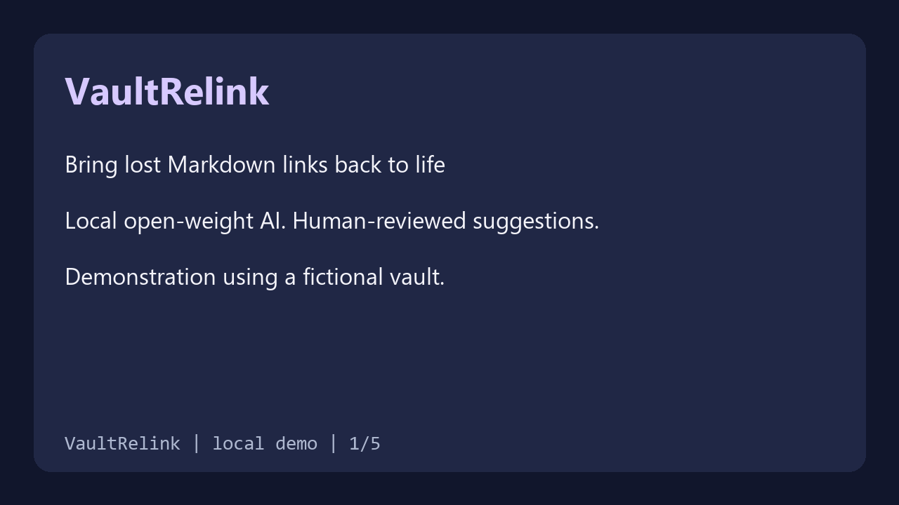

# VaultRelink

Recover forgotten links in a Markdown vault using local, open-weight AI. VaultRelink scans Markdown files, finds unresolved `[[wiki links]]`, ranks existing notes, and makes an HTML report with real excerpts and manual replacement suggestions. It never edits the vault.



## Try the demo (Windows)

Python 3.11 on an AVX2-capable CPU is recommended. Model download is approximately 118 MB and requires internet once. Afterwards, scanning and inference run locally. Dependencies and model must be obtained separately; they are not bundled in the repository.

```powershell
py -3.11 -m venv .venv
.\.venv\Scripts\python.exe -m pip install -r requirements.txt
.\.venv\Scripts\python.exe download_model.py
.\.venv\Scripts\python.exe vaultrelink.py demo-vault --output demo-report.html
```

Open `demo-report.html` in a browser. Use a new output filename for each run; existing files are never overwritten. For your own notes, pass a vault directory and an output path **outside** that vault:

```powershell
.\.venv\Scripts\python.exe vaultrelink.py "C:\path\to\vault-copy" --output "C:\path\to\report.html"
```

The report may contain note content. Keep it private. The demo vault is fictional and safe to share.

## How it works

The local `sentence-transformers/paraphrase-multilingual-MiniLM-L12-v2` model is pinned to revision `e8f8c211226b894fcb81acc59f3b34ba3efd5f42`, using its official AVX2 quantized ONNX export. Long notes are divided into overlapping token windows. Attention-mask-aware mean pooling produces normalized embeddings. For each broken link, cosine similarity and a small lexical overlap score rank candidate notes; the report displays the strongest actual excerpt per candidate. Scores are rankings, not probabilities, and there is no automatic acceptance or edit.

The scanner recognizes ordinary Obsidian-style wiki links in UTF-8 `.md` files. It excludes embeds, skips symlinks, and treats duplicate basename targets as ambiguous rather than missing. It does not implement all Obsidian resolution rules: frontmatter aliases, heading validation, Markdown code-block exclusion, and non-Markdown targets are not supported. Query context and very long filenames may be truncated at the model's 128-token limit. Review every suggestion and preserve a backup before making manual edits. Real-vault accuracy is unmeasured.

## Development

```powershell
.\.venv\Scripts\python.exe -m unittest -v test_vaultrelink
```

See `THIRD_PARTY_NOTICES.md` for model attribution. The initial synthetic feasibility benchmark evaluated semantic retrieval, not the final hybrid ranking or production accuracy.
